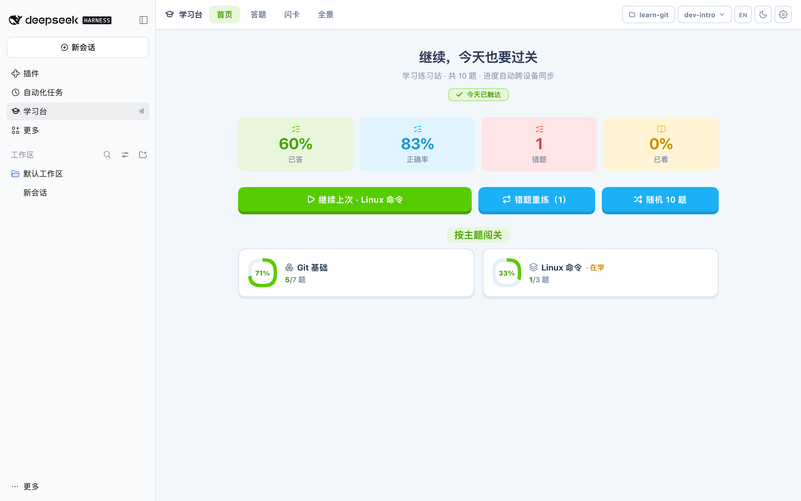
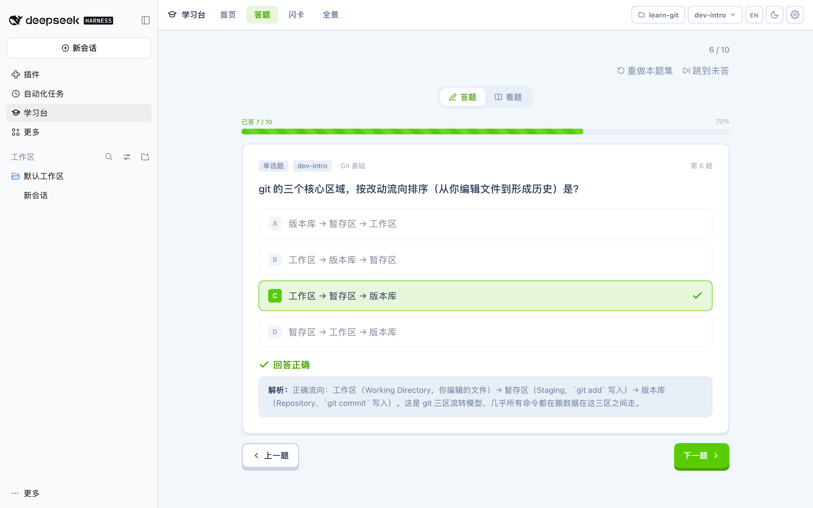

**English** | [简体中文](./README.md)

<p align="center">
  
</p>

<h1 align="center">dsh-ai-study-kit</h1>

<p align="center">Put an AI study coach inside DeepSeek Harness: one embedded "Study Desk" panel plus five <code>/study-*</code> commands.</p>

<p align="center">
  <a href="https://jerryjiao.github.io/dsh-ai-study-kit/en/">Website</a> ·
  <a href="https://jerryjiao.github.io/dsh-ai-study-kit/en/docs/">Docs</a> ·
  <a href="https://jerryjiao.github.io/dsh-ai-study-kit/en/changelog/">Changelog</a> ·
  <a href="CHANGELOG.md">CHANGELOG</a> ·
  <a href="docs/adr/">ADRs</a>
</p>



## What this is

The plugin has two halves that share the same local study data:

- **Study Desk (panel)**: the DSH-embedded version of the practice site itself. Four pages — Home / Practice / Flashcards / Panorama — switched by a secondary tab row at the top, in both Chinese and English. Questions, flashcards and lessons are read straight from your study project directory, and progress is written back to `progress.json` in that same directory.
- **Five skill commands**: `/ask-coach` is the main entry point (detect study state → snapshot → recommendation → guided execution), and the other four are direct shortcuts into it.

The plugin does not go online and does not collect data; your study content stays on your own machine. The skill bodies and the practice-site snapshot come from the open-source project [ai-study-kit](#source-and-acknowledgements).

## Quick start

### 1. Install

```bash
dsh plugin --profile web add \
  github:jerryjiao/dsh-ai-study-kit
```

Replace `web` with your profile name (`dsh plugin` requires `--profile`). The install succeeded once the plugin status is `active`: a Study Desk icon appears in the sidebar and the five `/study-*` commands are available.

### 2. Open the Study Desk

Click Study Desk in the sidebar. The plugin looks for your study project root in this order:

1. The path remembered from last time (your manual choice wins: the Study Desk is a workspace-wide panel, so unrelated working directories do not pull it off course);
2. The current DSH working directory (if it contains `examples/`);
3. `~/study-kit`;
4. If none of them exist, a directory picker opens.

To see it working first: clone this repository, point the project root at `kit/` inside the repo, and the bundled example theme `dev-intro` opens.

### 3. Use it

Home gives four entry points — resume last session / retry wrong answers / 10 random questions / level up by topic; the Practice page grades on the spot and shows an explanation; Flashcards queue by due date; the Panorama page colors exam points by mastery and recommends the next stop.

## What a study project looks like

The project root is the directory where you keep your study content, and the plugin recognizes only this structure:

```
my-study-project/                ← project root, location is up to you
├── examples/
│   └── git-basics/              ← one directory per theme
│       ├── questions.json       # questions: single / multiple / judge
│       ├── flashcards.json      # flashcards: front / back / exam point
│       ├── plan.json            # study plan (optional)
│       ├── theme-config.json    # display config such as the theme title
│       ├── MISSION.md           # arrangement table: exam point → EP / day
│       └── lessons/*.html       # lesson pages
└── progress.json                ← progress; the plugin creates it and merges writes back
```

- Question field example: `{ id, type, topic, day, examPoint, question, options, answer, analysis }`, where `type` is `single` / `multiple` / `judge`.
- What each file does and the direct-read conventions are in [docs/DETAIL.md](./docs/DETAIL.md); the whole example theme at `kit/examples/dev-intro` can be copied as a template.
- To have the coach open a new theme by process, use the F2 flow in `/study-coach` (the flow table is in `skills/ask-coach/references/`).

## Study Desk

| Page (top tab) | What it does |
|------|--------|
| Home | Answered / accuracy / wrong / read all on one screen; resume last session, retry wrong answers, 10 random questions and level up by topic all start here |
| Practice | Single-choice, multiple-choice and judge questions are graded on the spot; wrong answers get an explanation, and a multiple-choice question only counts when every option is right |
| Flashcards | Queued by due date; flip to see the answer, and after you rate "forgot / fuzzy / remembered" the next card's time is decided |
| Panorama | Exam points are colored by four states — "mastered / learning / weak / untouched" — and the next-stop recommendation jumps straight there to fill the gap |



A few implementation trade-offs:

- **Read source files directly**: JSON and HTML are read from `<project root>/examples/<theme>/` rather than from build output, so editing questions takes effect on refresh with no sync step ([ADR 0002](./docs/adr/0002-直读examples源文件.md)).
- **No server, no port**: the page and the host talk over local loopback RPC; no HTTP service is started and no proxy is set up ([ADR 0004](./docs/adr/0004-切除服务层保留内容流水线.md)).
- **Progress write-back is atomic**: read → merge → write a temp file → rename; when `progress.json` is corrupt or has the wrong shape the write is refused and reports `EPROGRESS_CORRUPT`, never resetting your records.
- **Bilingual**: switch in the top-right corner of the interface and the choice is remembered.
- **Legacy layouts are only flagged, never changed**: layouts copied out of the kit repository before the integration (`kit/apps/quiz-app/examples`, `kit/examples`) are recognized and a migration is suggested, but the plugin never touches your files.

More screenshots (flashcards, panorama, dark mode): [Website · What the Study Desk looks like](https://jerryjiao.github.io/dsh-ai-study-kit/en/#shots).

## The five commands

| Command | What it jumps into |
|------|----------|
| `/ask-coach` | Main entry point: detect study state (progress, wrong answers, due flashcards, exam date, version) → snapshot + recommendation → guided execution |
| `/study-coach` | Tutoring shortcut: sit down and study (F10 tutoring lesson) |
| `/study-doctor` | One-stop health check: brand scan / question-bank QA / four-way alignment / tests + environment detection |
| `/study-recap` | Wrong-answer walkthrough shortcut (F4) |
| `/study-podcast` | Podcast shortcut (F5) |

All five skills are **user slash invocations** (`userInvocable`) and are not added to the model catalog automatically by default (corresponding to the original project's `disable-model-invocation: true`). Some hosts prefix commands with the plugin namespace, e.g. `/dsh-ai-study-kit:ask-coach`.

## Three ways to install

- **Direct from GitHub** (recommended): `dsh plugin --profile web add github:jerryjiao/dsh-ai-study-kit`
- **Local directory** (development / unpublished): add a local plugin pointing at the repository root from the plugin management page, or `dsh plugin --profile web add /absolute/path/dsh-study-kit`
- **By package name** (after publishing to npm): `dsh plugin --profile web add dsh-ai-study-kit`

This plugin is a standard DSH bundle: `dsh.bundle.patch` in `package.json` points at `cordis.patch.yml`, and `dsh.client` declares the Study Desk frontend assets. To uninstall: `dsh plugin --profile web remove dsh-ai-study-kit`.

## Troubleshooting

- **No Study Desk in the sidebar**: the plugin is not `active`. Check its status on the plugin management page, or run `dsh plugin --profile web list`.
- **The command has a prefix**: some hosts add the plugin namespace to commands; try `/dsh-ai-study-kit:ask-coach`.
- **It says no study project was found**: make sure the selected directory contains `examples/<theme>/`, or have the coach open a new theme with the F2 flow.
- **A migration notice for a legacy layout**: move the themes under `kit/apps/quiz-app/examples` or `kit/examples` into `examples/` at the project root; the plugin only suggests, it never touches your files.

## Repository structure

```
dsh-study-kit/
├── package.json          # bundle manifest (patch, client)
├── cordis.patch.yml      # inserts this plugin into DSH
├── lib/index.js          # host entry: registers the skills
├── lib/client.js         # Study Desk frontend output (do not edit by hand)
├── src/host/             # project detection, reading examples, writing progress
├── src/client/           # four pages, tabs, i18n, state management
├── skills/               # the five skills (including reference material)
├── kit/                  # practice-site snapshot + the dev-intro example
├── references/           # contract / state detection / tone
├── locale/               # en / zh metadata
├── docs/adr/             # architecture decisions 0001–0005
├── scripts/              # build, dev-install, screenshots
├── website/              # Astro website (three pages)
├── test/                 # two node:test test files
├── CHANGELOG.md
└── LICENSE
```

## How it works

In `apply(ctx)`, `lib/index.js` strips the frontmatter from each `skills/<name>/SKILL.md`, registers it with `ctx.skills.register(...)`, and uses **the skill directory itself** as `resourceBase`. Because the base is the skill directory, the relative paths in the body (`../../references/*.md`, `<plugin root>/kit/…`) resolve verbatim against the absolute base that DSH reports, matching the original project layout.

The Study Desk half: `ctx.slots.inject('main')` + `ctx.slots.inject('sidebar.panellist')` register the panel and the sidebar entry; the frontend is bundled from `src/client` into `lib/client.js` and talks to the host over loopback RPC. Design trade-offs and decision records are in [docs/adr/](./docs/adr/).

## Compatibility

- DSH: `>=0.2.1-rc.5 <0.3.0`
- Node.js: `^22.19.0 || >=24.0.0` (build and tests; the plugin runtime only uses Node built-in modules)

## Development and testing

```bash
npm test              # all node:test cases
npm run build         # rebuild lib/index.js and lib/client.js (src/ → lib/)
npm run website:build # build the website into website/dist/
npm run screenshots   # re-shoot website screenshots with Playwright (bring your own isolated DSH profile)
```

Test coverage: bundle manifest and cordis patch consistency, the registration strategy and `resourceBase` of the five skills, frontmatter parsing, `apply()` registration and disposal, every relative link inside the skill bodies being reachable, alignment of the `kit` version with the CHANGELOG, and icon and locale completeness; on the Study Desk side, slot registration (`main` + `sidebar.panellist`), rendering of the four pages, bilingual resources, `examples/` reading and path-escape validation, and merging `progress.json` back on write plus refusing to write when it is corrupt. With `AI_STUDY_KIT_SRC=<upstream plugin directory>` set, the copied `skills/`, `kit/` and `references/` are compared byte for byte against upstream (recorded link fixes and privacy scrubbing are in [docs/DETAIL.md](./docs/DETAIL.md)).

## Documentation

- [Website](https://jerryjiao.github.io/dsh-ai-study-kit/en/): feature overview and screenshots
- [Docs page](https://jerryjiao.github.io/dsh-ai-study-kit/en/docs/): install, study project structure, data formats
- [Changelog](CHANGELOG.md) / [website version](https://jerryjiao.github.io/dsh-ai-study-kit/en/changelog/)
- [Detailed design and porting record](./docs/DETAIL.md): upstream capability inventory, mapping, difference ledger, verification method

## Source and acknowledgements

The skill bodies, the `kit/` snapshot and `references/` come from the open-source project **ai-study-kit** (MIT), copied as-is without changing a single line of runtime code. The parts ported to DSH (bundle manifest, `lib/index.js`, the Study Desk, tests, docs) are released under MIT as well. See [LICENSE](./LICENSE) for details.

## License

[MIT](./LICENSE)
